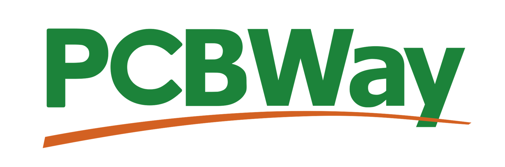

# splitmac

Split-keyboard ergonomics on a stock MacBook, in one Karabiner-Elements config.
The right hand moves a column over, the home row becomes modifiers and four hold
layers, and 30 keys you should stop reaching for are switched off.

The same keymap ships in two forms, and they are kept identical:

| | Where it runs | What it is |
| --- | --- | --- |
| [`karabiner/`](karabiner) | the MacBook's built-in keyboard | one `karabiner.json`, no firmware |
| [`qmk/`](qmk) | a [ZSA Voyager](https://www.zsa.io/voyager) | QMK firmware, so the layout travels with the board |

Learn it once on the laptop, plug in the split, same fingers do the same things.

<table>
  <tr>
    <td>
      
    </td>
    <td>
      This project is sponsored by <a href="https://www.pcbway.com/">PCBWay</a>,
      a one-stop shop for PCB prototyping, assembly, CNC machining and 3D
      printing. For the project background, ordering walkthrough and planned
      hardware coverage, see
      <a href="#sponsor">Sponsor</a> below for what they offer.
    </td>
  </tr>
</table>

Each layer is drawn twice: the MacBook deck first, then the Voyager. The small
grey legend in the corner of each cap is what is printed on the laptop key it
stands for; the big legend is what the key actually does.

---

### Base

<picture>
  <source media="(prefers-color-scheme: dark)" srcset="img/base-dark.svg?v=7">
  
</picture>

<picture>
  <source media="(prefers-color-scheme: dark)" srcset="img/voyager-base-dark.svg?v=3">
  
</picture>

### Number layer

<picture>
  <source media="(prefers-color-scheme: dark)" srcset="img/number-dark.svg?v=7">
  
</picture>

<picture>
  <source media="(prefers-color-scheme: dark)" srcset="img/voyager-number-dark.svg?v=3">
  
</picture>

### Symbol layer — left

<picture>
  <source media="(prefers-color-scheme: dark)" srcset="img/sym-left-dark.svg?v=7">
  
</picture>

<picture>
  <source media="(prefers-color-scheme: dark)" srcset="img/voyager-sym-left-dark.svg?v=3">
  
</picture>

### Symbol layer — right

<picture>
  <source media="(prefers-color-scheme: dark)" srcset="img/sym-right-dark.svg?v=7">
  
</picture>

<picture>
  <source media="(prefers-color-scheme: dark)" srcset="img/voyager-sym-right-dark.svg?v=3">
  
</picture>

### Navigation layer

<picture>
  <source media="(prefers-color-scheme: dark)" srcset="img/nav-dark.svg?v=7">
  
</picture>

<picture>
  <source media="(prefers-color-scheme: dark)" srcset="img/voyager-nav-dark.svg?v=3">
  
</picture>

There is also an [interactive version](keymap.html) of the laptop diagrams —
open it and press keys on your own keyboard to light up the matching cap, or
hold Space and a layer key to preview a layer live.

Inspired by [@getreuer's QMK keymap](https://github.com/getreuer/qmk-keymap),
which is the reference for what a well-documented personal keymap looks like.

---

## The idea

A laptop keyboard has no thumb cluster and no layer keys, so the usual QMK
tricks do not port over directly. This config works around that with three
moves:

1. **Everything worth reaching for moves onto the home row.** Numbers, symbols
   and arrows live on hold layers, not on the number row.
2. **Space and Right Command become gates.** Hold either one and that hand's
   home row turns into modifiers and layer keys. Let go and it is plain letters
   again — so there are no accidental mod-taps while typing at speed.
3. **The keys you should stop using are disabled.** The number row, `esc`,
   `tab`, `delete`, `caps lock`, `return`, Left Control, Left Option, the arrow
   cluster and the four alpha keys between the hands do not do their job any
   more.

The Voyager has real thumb keys, so it does not need any of the workarounds —
but it runs them anyway, so both boards feel identical.

## Sponsor

[PCBWay](https://www.pcbway.com/) sponsors this project. They offer PCB
prototyping and assembly alongside CNC machining, sheet metal fabrication,
injection moulding and 3D printing. For keyboard builders, those services
provide options for custom electronics, plates, enclosures and mounts.

Splitmac currently provides software for a MacBook and the commercial ZSA
Voyager. This repository does not yet document a PCBWay-manufactured part.

The [PCBWay project write-up](docs/pcbway.md) covers the project background,
an ordering walkthrough, the planned unboxing and measurement coverage, the
final application, and the benefits of PCBWay's services. Actual order
screenshots, part photographs and inspection results are pending; the
write-up identifies what is still needed.

If you use them, say hello from `splitmac`.
